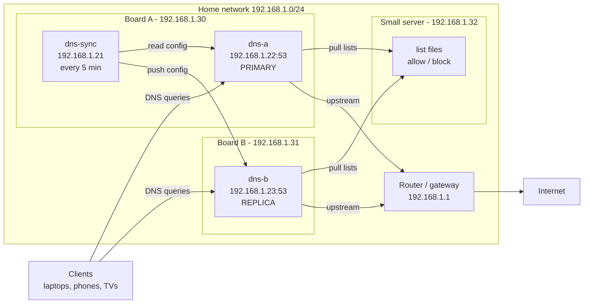
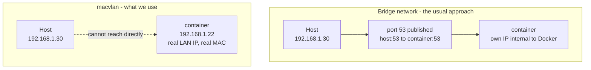
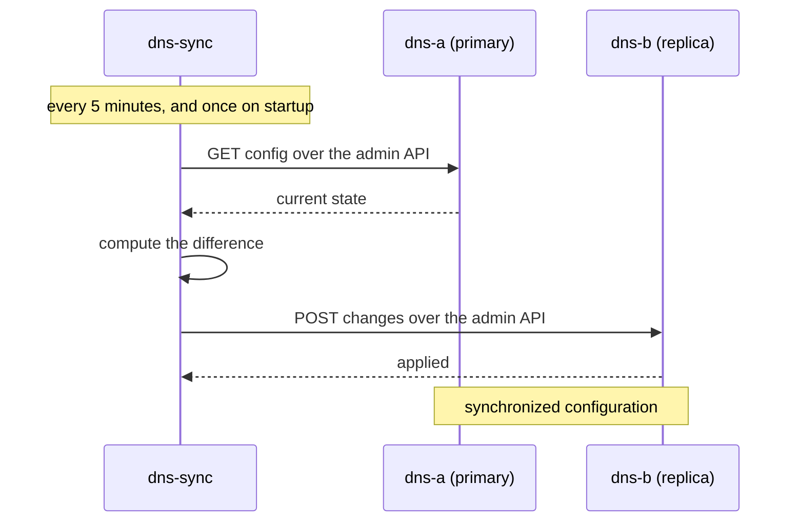
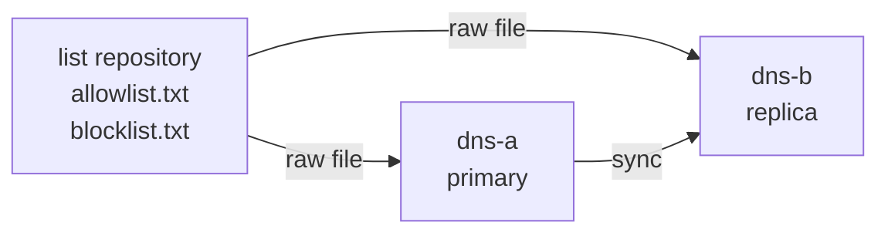
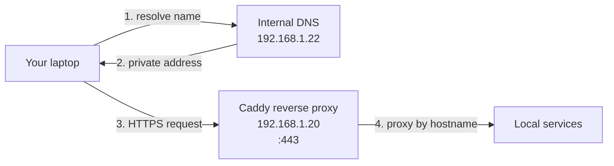

You may not realize it, but a good DNS resolver is invisible. You only notice it when it stops being good. Ours stopped being good, and the fix turned out to be bigger than replacing one tool with another: it became a small system with two servers, a synchronization loop, and a domain with service hostnames that resolve only inside the house.

This is the story of that build, the three reasons behind it, and the design decisions that actually mattered.

# Why I rebuilt it

Three problems prompted me to rebuild my setup, and they all surfaced around the same time.

I was experiencing recurring issues with Pi-hole, but I was also looking to build my own intranet. I didn't want to rely on `.local`, `.lan`, or similar naming conventions. I wanted a real domain, valid TLS certificates, redundant DNS servers, and a single place to manage my allowlists and blocklists.

What started as a DNS problem became an opportunity to rethink the architecture of my entire homelab.

## 1. Pi-hole kept breaking

Pi-hole was the starting point, and for a while it was fine. Then it began to fail in ways that were hard to diagnose: updates that broke the web interface, a database that grew until queries slowed down, and filtering rules that behaved inconsistently across client groups. None of it was catastrophic. All of it was annoying, and the annoyance was constant.

The deeper issue was that recovery meant rebuilding. It was running directly on a small Raspberry Pi, not in a container, and every time I needed to update it, my network lost DNS resolution. When my Pi-hole came back wrong, the fastest path was often to start over and reapply the configuration by hand. That is acceptable in a lab and unacceptable in the one piece of infrastructure every device in the house depends on.

## 2. DNS has to be redundant

This was the reason that mattered most.

When a single resolver goes down, the failure is not graceful. Browsers stall while they wait for a timeout that may never resolve into a clear error. Phones show a full Wi-Fi signal and load nothing. Streaming boxes report that the internet is down even though the router, the link, and the ISP are all fine.

One server is a single point of failure for every device in the house. If DNS is the thing everything depends on, then "one machine" is not a design, it is a pending outage.

## 3. Building a private intranet with publicly trusted TLS certificates

The third reason was convenience that turned into something more useful. Managing services by IP address stops scaling quickly. You end up with a list of numbers in a note, and no memory of which number runs which service.

What I wanted was a name. A real name, on my own domain, with a real certificate, so the browser shows a padlock instead of a warning. Nothing published to the internet, and nothing exposed outside the network. Just a proper web address for the things running at home.

Although I own a publicly registered domain, my internal service hostnames have no public A or AAAA records in my Cloudflare DNS zone.

Instead, my local AdGuard Home instances resolve those hostnames to private IP addresses. TLS certificates are obtained through the DNS-01 challenge, allowing me to use publicly trusted certificates without exposing my internal services to the internet.

# The shape of the solution

Two AdGuard Home instances, on two separate physical boards, a Raspberry Pi and an Orange Pi, with their configurations kept in sync by a dedicated synchronization container. Both DNS instances actively serve client requests. The primary and replica roles apply to configuration management, not to DNS query processing.

One instance is the source of truth. The other is a follower. You only ever edit the primary, and the changes appear on the replica automatically.



The important detail in that diagram is that `dns-sync` is a peer on the network, even though it runs on one of the boards. This was a design decision driven by the networking choice, as the next section explains.

# Why macvlan changes everything

The containers do not use port mapping. Each one gets its own IP address and its own MAC address directly on the local network, using a **macvlan** network.



With a bridge and a published port, the container hides behind the host address, and you reach it through a port mapping. With macvlan, the container is a device on the network in its own right. It has a genuine address on the subnet, and it needs no port mapping at all.

This matters for DNS specifically. A resolver that is a first-class citizen on the LAN is easier to reason about, easier to point clients at, and easier to move between hosts. If the container moves, the address moves with it, and no client configuration changes.

## The catch nobody mentions first

There are workarounds, such as creating a host-side macvlan interface, but assigning the synchronizer its own LAN address was the simplest solution for my environment.

macvlan has a sharp edge, and it is a kernel restriction rather than a bug or a misconfiguration: **containers on a macvlan network cannot communicate directly with their own host through its parent interface by default.**

This has one consequence that surprises people. You cannot reach the AdGuard admin interface from the board that runs it. You open the browser on a laptop, or a phone, or any other machine on the network. Not on the host itself.

That restriction is also why the synchronization container gets its own macvlan address. If it ran on the host network, it could not reach the DNS containers it is supposed to synchronize. Giving it a real address on the LAN turns it into a peer, and suddenly it can talk to both the primary and the replica over the network, exactly as any other client would.

# Keeping two servers identical

Running two resolvers is easy. Keeping them honest is the hard part, and the failure mode is nasty: a rule added to one instance and forgotten on the other produces results that differ depending on which server a device happened to ask. Debugging that is miserable, because the same query succeeds or fails based on chance.

The goal is to minimize configuration drift through automated, unidirectional synchronization. One instance is the source of truth and the replica is a follower, with a synchronizer running on a fixed schedule.



The synchronization runs over the same HTTP API the web interface uses. It does not care that the two instances live on different physical machines, as long as both addresses are reachable on the local network.

What gets synchronized: rewrites, filter and block lists, custom rules, client settings, and general settings. What this means in practice is simple. **You maintain one server.** The other one follows automatically, provided the synchronizer is running successfully. Both instances and the synchronization process still need monitoring.

## Resource cost

This is the part that makes redundancy affordable. Each AdGuard Home instance idles around 50 MB of RAM and under one percent of a CPU core, rising to roughly 100 to 150 MB and a few percent under real query load. The synchronizer is smaller still.

Two boards that were already sitting idle now cover the house. The redundancy cost almost nothing in hardware, because the hardware was already there.

# Lists as files instead of clicks

Filtering rules entered through a web interface are slow to manage and impossible to review. Instead, the allow and block lists live as plain text files in a small git repository, and both instances pull from the same source.



There is a second benefit beyond version control. Both instances retrieve their filtering rules from the same URLs, reducing configuration drift and promoting eventual consistency. Temporary differences are still possible if the lists are refreshed at different times or a refresh fails.

The syntax is standard adblock style, which is worth noting because it is not the same as the older Pi-hole regex format:

```text
# allowlist - permits a domain and all of its subdomains
@@||example.com^

# blocklist - blocks a domain and all of its subdomains
||ads.example.net^
```

The `||` anchors to the domain, and the trailing `^` matches the separator, which is what makes the rule cover subdomains without listing them. A file of a dozen lines replaces a pile of individual entries in a UI, and it lives in git where changes are reviewable.

# The domain that stays inside

This is the third reason from the beginning, and the part that makes the setup feel finished rather than merely functional.

The services answer on real names under a domain I control, with valid certificates. The services are not exposed to the internet, and no public A or AAAA record points to them.



The flow that makes this work has two separate halves, and keeping them separate is what gives the design its flexibility:

- **Resolution** is internal. The local DNS answers with a private address for names it knows.
- **Certificates** come from a public certificate authority, validated through a DNS-01 challenge rather than a web request. The challenge uses public DNS TXT records, so the certificate can be issued even when the service hostname has no public A or AAAA record.

The result is a browser padlock rather than a warning page, on names that resolve to services only inside the house. The certificates renew on their own, and no service is ever exposed to the internet to obtain or maintain them.

One privacy consideration is Certificate Transparency: publicly trusted certificates can reveal individual hostnames in public logs. A wildcard certificate can avoid listing each internal service hostname individually, although the wildcard name itself may still be public.

This is the piece that turns a collection of IP addresses and ports into something that behaves like a real service.

# What I would tell someone starting today

**Redundancy is worth it earlier than it feels.** The cost is one extra container and a synchronizer, on hardware you probably already own. The benefit is that a reboot, an update, or a failed board no longer takes the whole house offline.

**Fix configuration drift before it bites.** A synchronizer is not a nice-to-have when you run two resolvers. It is the thing that makes the second resolver safe to have. Without it, two servers are a debugging problem, not a safety net.

**Understand the network mode before you commit.** macvlan gives containers real addresses and removes port mapping entirely, which is genuinely better for DNS. It also imposes a host-to-container restriction that will confuse you at the worst moment if you learn about it after the fact.

**Keep rules in files.** Anything you would want to review, diff, or roll back belongs in version control, not in a web form.

**Names change the experience more than features do.** Reaching a service by name, with a valid certificate, is the difference between something that works and something that feels built.

The part I did not expect is that the third reason, the certificate and the name, would end up mattering as much as the redundancy. The redundancy is what you build so nothing breaks. The name is what you build so it is pleasant to use. Both are worth doing, and they are cheaper together than separately.

# What's next?

This experience reminded me why I enjoy building and experimenting with my homelab. Every problem is an opportunity to learn, challenge assumptions, and make better architectural decisions.

I'm considering turning these experiences into a series called **Engineering My Homelab**, where I'll share not just what I've built, but why I built it, the challenges I faced, and the lessons I learned along the way.

Would you be interested in following this series? I'd love to hear your thoughts. 


